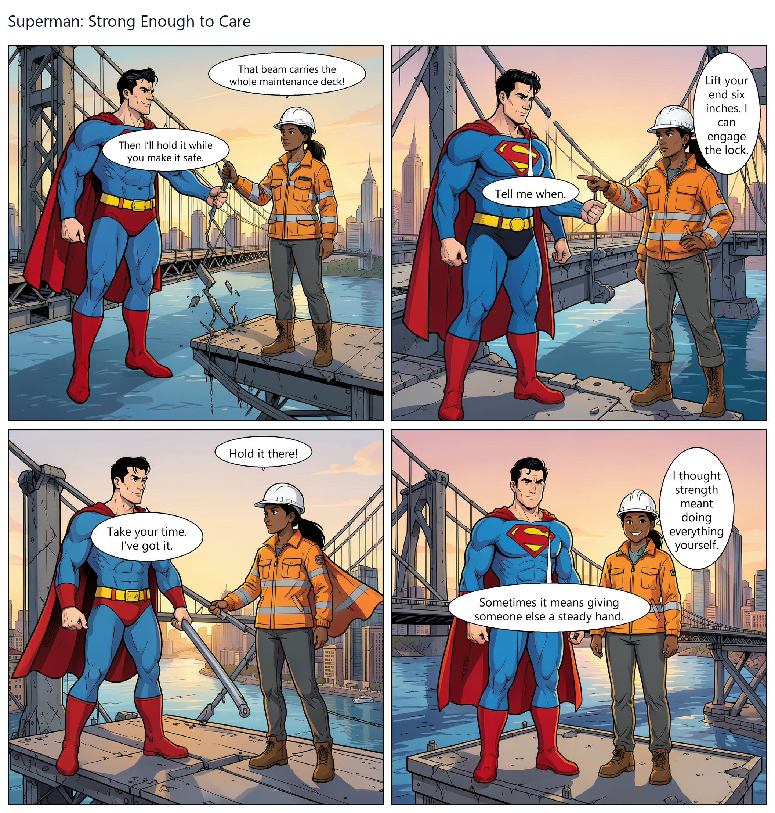
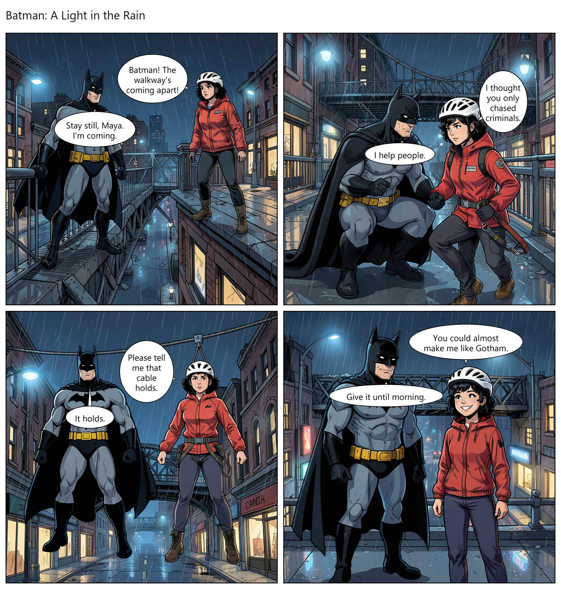
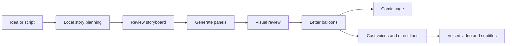

# Comic Factory

### Your idea → a lettered comic → a voiced video, on your Windows PC

[Download Windows beta](https://github.com/Brijendrasial/comic-factory/releases/tag/v0.1.0-beta.1-full) · [Report an issue](https://github.com/Brijendrasial/comic-factory/issues) · [Model manifest](model-manifest.json) · [MIT license](LICENSE)

**0.1.0-beta.1 · Windows x64 · NVIDIA GPU · Local inference · No paid API key**

Comic Factory connects a local writer, image generator, visual reviewer and expressive speech model in one desktop workflow. Start with an idea or panel script, review the storyboard, and export a comic page and a video with character dialogue.

This is an early beta. Local packaging, install, launcher and uninstall checks have passed. A separate clean-PC setup and full-generation test remain outstanding. Artwork, story continuity, lettering and voice performances still need human review.

## Demo gallery

Actual pages from the creator's local projects, displayed as exported. These show artwork and font-rendered speech balloons; still images do not demonstrate voice quality. Results vary between projects and versions.

### Superman: Strong Enough to Care

A bridge rescue with warm sunset colors and in-panel dialogue.



### Batman: A Light in the Rain

A rainy rooftop rescue with contrasting character costumes and night lighting.



These user-created AI fan-art demos are not official DC publications or endorsements. Superman, Batman and related marks belong to their respective rights holders. The application's MIT license does not grant rights to those characters or demo artwork. The gallery is documentation and is not bundled in the Windows installer.

## Features

| Capability | In this beta |
|---|---|
| Story planning | Turn an idea into a structured plan, or supply an explicit panel script |
| Character direction | Provide names, appearances, costumes and continuity notes |
| Local artwork | Generate comic illustrations with FLUX.2 Klein 4B |
| Visual review | Flag possible defects using a local vision model, with bounded retries and review holds |
| Comic lettering | Draw speech balloons and text using fonts instead of asking the image model to paint words |
| Storyboard editing | Edit dialogue, regenerate panels and adjust speaker-mouth anchors for balloon tails |
| Character speech | Assign different stock speakers and emotional directions to dialogue lines |
| Video export | Combine comic imagery, speech, subtitles and optional background music |
| Resume and reuse | Resume saved projects or rebuild their voices/video while keeping the drawings |

**Video is a voiced comic presentation, not full character animation or lip sync.**

## AI model stack

These are the models pinned by this release. Setup downloads their weights to your selected data folder; inference runs locally.

| Job | Model / distribution | Format | Approx. model download |
|---|---|---|---|
| Story planning | [Qwen3-4B-Instruct-2507](https://huggingface.co/unsloth/Qwen3-4B-Instruct-2507-bnb-4bit), Unsloth distribution | bitsandbytes 4-bit | 2.49 GiB |
| Panel artwork | [FLUX.2 Klein 4B](https://huggingface.co/hlhc/FLUX.2-klein-4B-bnb-4bit), hlhc distribution | bitsandbytes 4-bit | 4.50 GiB |
| Visual review | Qwen3-VL 4B Instruct through Ollama: `qwen3-vl:4b-instruct-q4_K_M` | GGUF Q4_K_M + vision projector | 3.11 GiB |
| Character speech | [Qwen3-TTS-12Hz-1.7B-CustomVoice](https://huggingface.co/Qwen/Qwen3-TTS-12Hz-1.7B-CustomVoice) | CustomVoice stock speakers | 4.21 GiB |

Sizes are approximate pinned model file totals, not VRAM requirements. The manifest records these models as Apache-2.0; upstream terms still apply. See [third-party notices](THIRD_PARTY_NOTICES.md).

<details>
<summary>Exact model revisions and runtime versions</summary>

| Component | Pinned version / revision |
|---|---|
| Story model | `f12db89cd5156e090618dded9b4367f23f8f3b33` |
| Artwork model | `199c1411ab9dc4111e9fe7e8e3dc3fc4e63c2648` |
| Speech model | `0c0e3051f131929182e2c023b9537f8b1c68adfe` |
| Visual reviewer | Registry revision `84f7ed8042fa7cdbd902f7dcb7d0370e032095047cc3244179f263b77b5bc318`; layer digests in [reviewer-manifest.json](reviewer-manifest.json) |
| Private Python | 3.12.16, python-build-standalone release 20261026 |
| Private Ollama | 0.40.13, Windows AMD64 |
| GPU runtime | PyTorch 2.11.0 + CUDA 12.8 wheels; TorchVision 0.26.0 |
| Image pipeline | Diffusers 0.39.0, Transformers 4.57.6, bitsandbytes 0.50.2 |
| Speech pipeline | qwen-tts 0.1.1, Transformers 4.57.3 in a separate voice environment |
| Desktop / export | Python/Tk, Pillow lettering, imageio-ffmpeg video export |
| Installer | PyInstaller-frozen, per-user Windows x64 installer |

Full dependencies: [engine requirements](requirements-engine.txt), [voice requirements](requirements-voice.txt), [engine constraints](constraints-engine.txt), [voice constraints](constraints-voice.txt).

Models run in stages to conserve GPU memory. Engine and speech use separate environments while sharing the private GPU runtime. Model revisions, file sizes and SHA-256 hashes are pinned in [model-manifest.json](model-manifest.json).

</details>

## Workflow



Explicit panel scripts can bypass freeform story drafting. Visual review can trigger retries or manual review holds; it cannot guarantee correct anatomy or continuity.

## Install and first run

1. Open the [beta release](https://github.com/Brijendrasial/comic-factory/releases/tag/v0.1.0-beta.1-full) and download **ComicFactory-Setup-0.1.0-beta.1.exe**. The source ZIP is for developers.
2. Run the installer, then open **Comic Factory**.
3. Click **Set up my PC**. The wizard checks hardware and prerequisites, installs private runtimes, downloads models and runs readiness checks.
4. Click **Open Comic Factory**, enter an idea, then choose **Plan story first** or **Make one comic**.
5. Review the storyboard, drawings, lettering and audio before sharing your comic.

End users do not need Python, pip, Git, terminal commands or a paid API key. First setup needs internet and roughly **20 GB of downloads**, depending on GPU packages. Keep **60 GB free** plus room for projects. Interrupted model downloads resume on retry. Generation runs locally once setup is complete.

The installer is **unsigned**. Windows may show an unrecognized-publisher notice. Release downloads include `ComicFactory-SHA256SUMS.txt` for checksum verification.

### Supported hardware

| Requirement | Beta target |
|---|---|
| OS | Windows 10/11, x64 Intel/AMD PC |
| GPU | NVIDIA Ampere or newer, such as RTX 30/40/50 series |
| VRAM | At least 8 GB |
| RAM | At least 24 GB; 32 GB recommended |
| Storage | 60 GB free for setup, plus project exports |
| Prerequisites | Current NVIDIA driver and Microsoft Visual C++ x64 runtime |

AMD graphics, Intel-only graphics, Apple Silicon and CPU-only machines are not supported by this beta. Drivers, available memory and laptop power limits can affect operation. System prerequisite installation may require administrator approval through the vendors' installers. No render-time benchmark is promised.

## Prompting guide

Start with one four-panel page and a small cast:

> Create a four-panel science-fiction rescue comic about Rowan, an adult male rescue pilot in a blue flight suit, and Asha, an adult female engineer in an orange work jacket. Asha is stranded on a damaged station walkway. Rowan helps her reach safety. Use consistent costumes, clear poses, readable speech balloons, and separate character voices. End with relief and gentle humor.

For more control, use an explicit script:

```text
TITLE: The Last Handrail

CHARACTER REFERENCES:
ROWAN: Adult male, muscular build, short dark hair, blue flight suit.
ASHA: Adult female, short black hair, orange work jacket, gray trousers.

SETTING: A space-station walkway at sunrise. Clean superhero-comic ink lines.

PANEL 1
Visual: Wide shot. Asha grips a damaged railing; Rowan stands across the gap.
ASHA: [worried] The cable is breaking!
ROWAN: [reassuring] Hold the railing. I'm coming.

PANEL 2
Visual: Rowan braces against a support, extending a rescue line.
ROWAN: [urgent] Clip this onto your harness.

PANEL 3
Visual: Asha holds the secured line, eyes focused on Rowan.
ASHA: [calm] Ready when you are.

PANEL 4
Visual: Both stand safely beside the airlock, smiling in warm light.
ASHA: [relieved] Next time, we take the elevator.
ROWAN: [happy] You read my mind.
```

Give each panel one drawable moment. Keep names and costumes consistent, use one or two short balloons per panel and leave room above faces for lettering. A long prompt alone does not guarantee an exact-length finished book; review page count and story structure.

### Voices and emotion

Character profiles guide stock-speaker casting. Explicit male/female descriptions help avoid incorrect assignments. In the current casting logic, Superman and Batman default to **Ryan**, directed toward a low, steady baritone. This is not an imitation of a particular actor.

Built-in directions include `[angry]`, `[fearful]`, `[worried]`, `[urgent]`, `[reassuring]`, `[relieved]`, `[sad]`, `[happy]`, `[dry]` and `[calm]`. The cue is removed from printed/spoken dialogue and used to direct speech. Performance remains probabilistic; a cue does not guarantee a particular pitch or emotion.

**The application's current pipeline is English-only.** Broader upstream model language abilities do not mean Hindi or multilingual comic generation is supported end to end. Stock voice pools are finite; reduce a large cast or configure explicit voice overrides.

### Review and outputs

- **Review storyboard:** edit lines, regenerate panels, or select a speaker and click their mouth to adjust balloon-tail anchors.
- **Resume saved comic:** continue an unfinished project with its saved story and assets.
- **Upgrade voices and video:** rebuild speech and video while preserving drawings.

Projects include `story.json`, the page `comic.png`, panel/audio assets and video exports. Intermediate outputs can include `comic_narration.mp4` and `subtitles.srt`. Keep the project folder to retain edits and resume work.

## Storage, privacy and repair

| Item | Default location |
|---|---|
| Installed app | `%LOCALAPPDATA%\Programs\ComicFactory` |
| Models, environments, settings and projects | `%LOCALAPPDATA%\ComicFactory` |
| Custom data-folder preference | `%LOCALAPPDATA%\ComicFactoryLauncher\storage.json` |
| Diagnostics | `logs` inside the chosen data folder |

You can choose a different data folder. `COMIC_FACTORY_HOME` explicitly overrides the saved setting. The app does not modify global Python or PATH. Uninstall removes receipt-owned app files and shortcuts while preserving comics and models.

There is no application telemetry or hosted inference. Setup contacts upstream services including GitHub, Hugging Face, PyPI, PyTorch and the Ollama registry. Generation and prompts stay local in this workflow. Check logs for personal paths and story text before posting them publicly.

Repair from the Start menu shortcut or run `ComicFactory.exe --setup`.

## Troubleshooting

| Problem | What to try |
|---|---|
| Unsupported hardware / insufficient disk space | Check the requirements and free space in the selected data folder |
| Download interrupted | Retry setup in the same folder to resume partial model downloads |
| Missing driver / Visual C++ runtime | Install from the official vendor, then rerun setup |
| Story fails validation | Shorten the request, use consistent names or supply an explicit four-panel script; inspect saved drafts |
| Balloons cannot fit | Shorten lines, reduce balloon count or adjust speaker anchors |
| Missing limbs / wrong clothing | Regenerate the affected panel with simpler poses and explicit costume references; inspect it yourself |
| Wrong voice / emotion | Correct character profiles and delivery cues, then rebuild voices/video |
| GPU memory failure | Close other GPU-heavy apps, reduce image size and retry; CPU fallback is not promised |

For [issues](https://github.com/Brijendrasial/comic-factory/issues), include the app version, Windows version, GPU/VRAM, failing stage and sanitized error excerpt. Do not upload credentials or entire private project folders.

## Known limitations

- Visual review can miss extra/missing limbs, wrong costumes and continuity errors. It cannot certify perfect artwork.
- Balloon placement and tail direction may need manual adjustment.
- Complex requests can fail story validation or drift from the prompt.
- Character appearance and vocal performances can vary; stock speakers are not unlimited bespoke actors.
- English is the supported application language. Videos use still comic imagery rather than animated characters.
- Local packaging tests do not replace clean-PC, end-to-end generation tests. This installer is unsigned.

## Build and maintain

On Windows x64 with Python 3.12:

```powershell
git clone https://github.com/Brijendrasial/comic-factory.git
cd comic-factory
python tools/build_release.py
```

The build bootstraps its tools and creates a frozen launcher, per-user installer and `SHA256SUMS.txt` under `release`. It needs internet for build tools but does not bundle model weights or personal caches. The installer verifies its embedded payload before extraction.

```powershell
python -m unittest discover -s tests
```

The initial beta passed 14 local packaging tests plus installation, frozen-launcher and uninstall-preservation smoke checks. These are not image-quality or clean-PC generation tests.

### Repository map

| Path | Purpose |
|---|---|
| `launcher.py` | First-run setup, repair and launch |
| `setup_core.py` | Hardware checks, private runtimes and verified downloads |
| `installer_main.py`, `installer_ops.py` | Installer UI, owned-file receipts and uninstall |
| `engine/` | Story, artwork, visual review, lettering, speech and exports |
| `model-manifest.json`, `reviewer-manifest.json` | Pinned model assets and checksums |
| `requirements-*.txt`, `constraints-*.txt` | Packages and dependency constraints |
| `tools/` | Release builds and manifest refresh |
| `tests/` | Packaging and setup checks |
| `docs/demos/` | README demo images |
| `.github/workflows/windows-release.yml` | Windows artifacts and draft version-tag releases |

Refresh model metadata with `python tools/refresh_manifest.py`, then review revisions, hashes, sizes and licenses before shipping. See [RELEASING.md](RELEASING.md) and [SECURITY.md](SECURITY.md). The workflow creates draft releases for review; it does not establish signing or production readiness.

## Licenses and credits

Application code is [MIT licensed](LICENSE). Models, Python, CUDA components, fonts and dependencies keep their own terms: [THIRD_PARTY_NOTICES.md](THIRD_PARTY_NOTICES.md). Thanks to Qwen, Black Forest Labs, Unsloth, Hugging Face, Ollama, PyTorch, Python and the maintainers of the quantized distributions used here.

No model weights, credentials or private project folders are included. The selected demo images are documentation; their character rights are separate from the code license.
